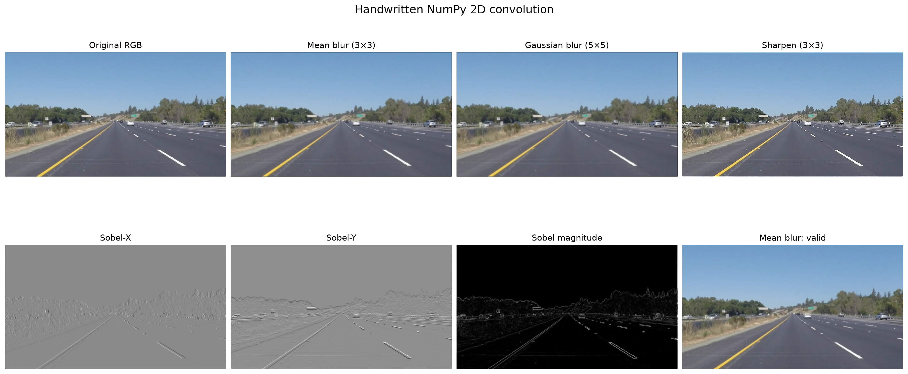

# Task 2：猫狗分类 · 实践 1：卷积核

运行程序：

```powershell
python -m pip install numpy pillow matplotlib torch
python CNN卷积核实践.py
```

题目所给图片已随作业保存为 `assets/road_scene.png`。运行后会在 `outputs/convolution_comparison.png` 生成下图。程序没有调用 OpenCV、SciPy 或 PyTorch 的现成卷积函数；核心逐位置、逐元素乘加过程由 NumPy 手写实现。



## 1. 数字图片的表示

像素（pixel）是图像网格中的一个位置，保存这个位置的颜色或亮度。RGB 指红（R）、绿（G）、蓝（B）三个颜色通道。本题图片为 `uint8` 格式，一个通道的典型范围为 0--255；0 表示该颜色分量最弱，255 表示最强。

灰度图每个像素只有一个亮度值，数组一般是 `(H, W)`；RGB 彩色图每个像素有三个值，数组一般是 `(H, W, 3)`。

## 2 Shape dtype max\min

| 表示             | shape                 | dtype         | 最小值 / 最大值  |
| -------------- | --------------------- | ------------- | ---------- |
| Pillow         | `RGB`，尺寸 `(960, 540)` | —             | —          |
| NumPy          | `(540, 960, 3)`（HWC）  | `uint8`       | `16 / 255` |
| PyTorch Tensor | `(3, 540, 960)`（CHW）  | `torch.uint8` | `16 / 255` |


Pillow/NumPy 常见 **HWC** 排列，即“高、宽、通道”；PyTorch 常见 **CHW** 排列，即“通道、高、宽”。

## 3. 二维卷积

卷积核（kernel/filter）是一个很小的数字矩阵，例如 3×3。它像一个滑动的小窗口，从左到右、从上到下扫过图片；窗口停在一个位置时，将该窗口内每个像素分别与卷积核对应位置的权重相乘，再把所有乘积相加，得到输出图的一个像素值。`stride` 决定窗口每次移动几格。
## 6. 四种卷积结果与解释

| 处理   | 使用的核 / 计算                            | 观察与原因                                                 |
| ---- | ------------------------------------ | ----------------------------------------------------- |
| 均值模糊 | 3×3 元素均为 `1/9`                       | 每个像素被邻域平均值取代，局部明暗差异被混合，模糊化了。               |
| 高斯模糊 | 5×5 高斯函数采样核，`sigma=1`                | 同样是局部加权平均，但中心权重最大、远处权重较小，所以通常比均值模糊自然。                 |
| 锐化   | `[[0,-1,0],[-1,5,-1],[0,-1,0]]`      | 中心值减去上下左右，放大像素与周围不同的高频部分；让轮廓更清晰。                 |
| 边缘检测 | Sobel-X、Sobel-Y，合成 `sqrt(Gx² + Gy²)` | X 核检测左右亮度变化（对应竖直边缘），Y 核检测上下变化（对应水平边缘）；两者合成后能显示各方向的边缘。 |

## 7. `valid` 与 `same`

- `valid`：不填充，输出为 `(538, 958, 3)`；边缘没有足够的邻居，因而不产生输出。
- `same`：四周各补 1 个零，输出保持为 `(540, 960, 3)`。零值会参与边缘附近的计算，故边缘可能略暗。
