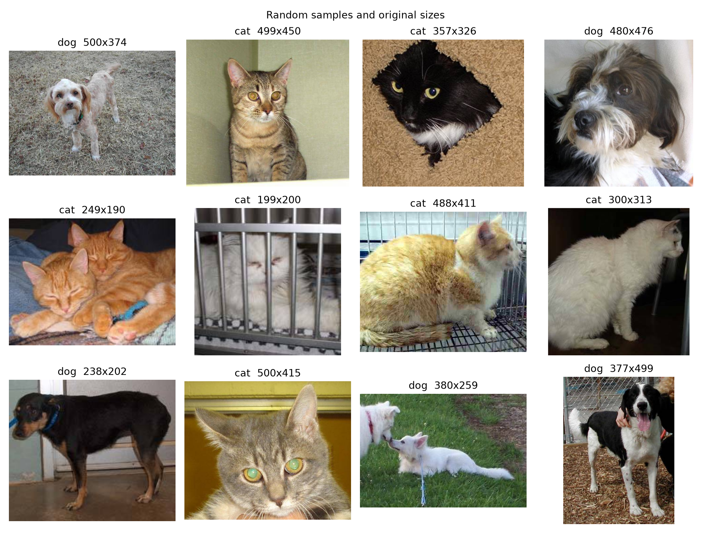
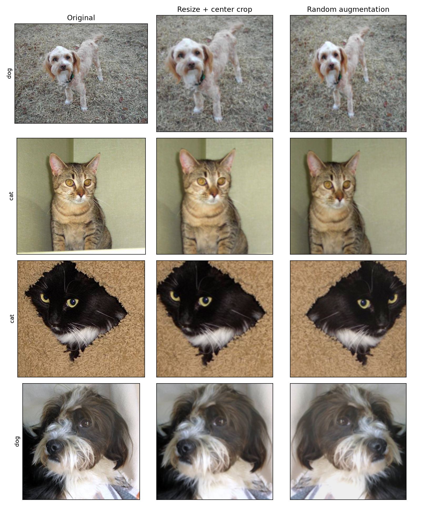
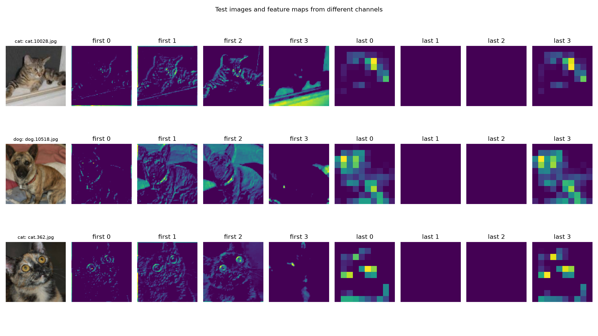
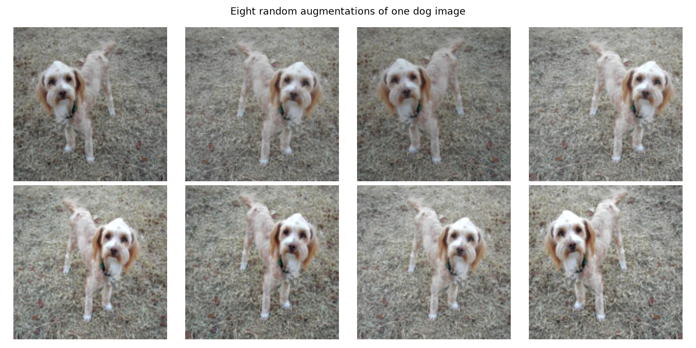
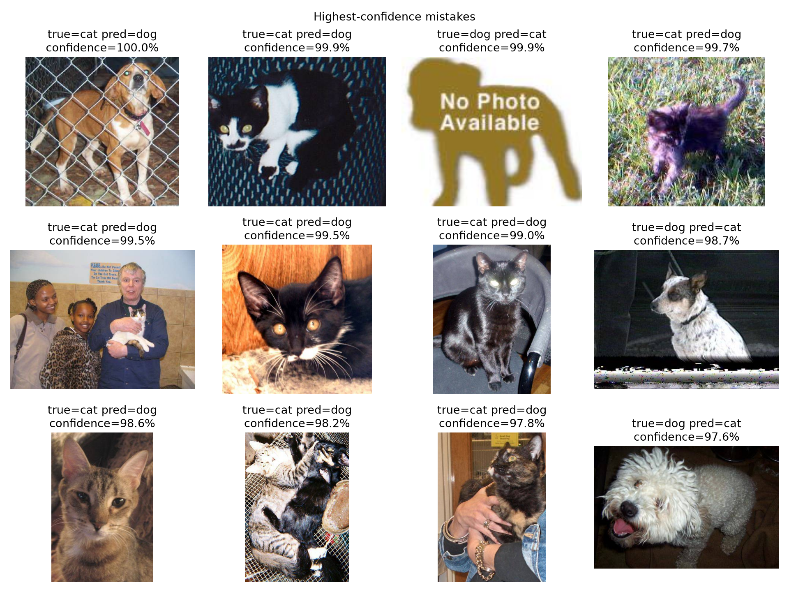
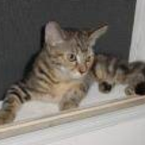
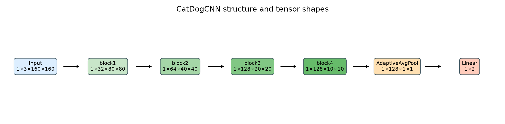

# 实践 2：训练猫狗分类器

## 1. 观察数据

训练包里有猫 12,500 张、狗 12,500 张。尺寸并不统一，例如 500×374、199×200；有清晰的特写，也有模糊的小图。背景，动物数量也不尽相同。



## 2. 读取图片和组成 batch

程序按文件名读出猫或狗的标签。每张图先保持比例缩放，再裁成 160×160，转为 RGB Tensor 并归一化；一次取 64 张，组成 `(64, 3, 160, 160)` 的 batch，最后一批可能少于 64 张。对比图里没有明显拉伸或颜色异常，少量边缘被裁掉，动物主体仍在。



## 3. CNN 模型

用了四组“卷积 → ReLU → 最大池化”，最后接平均池化和全连接层，输出猫、狗两个得分。卷积负责找局部特征，池化缩小特征图。

## 4. 各层形状

一张图片经过模型时：

```text
(1, 3, 160, 160)  输入
(1, 32, 80, 80)  第1组
(1, 64, 40, 40)  第2组
(1, 128, 20, 20) 第3组
(1, 128, 10, 10) 第4组
(1, 128, 1, 1)   平均池化
(1, 2)           猫、狗得分
```

每次池化都让宽和高减半；通道数增加，表示模型能记录更多种图像特征。

## 5. 特征图

图中选了测试集的两张猫图和一张狗图。第一层不同通道有的突出轮廓和毛发纹理，有的突出明暗区域；最后一层更粗略，有些通道在动物所在位置亮，有些几乎不响应。只能说这些区域引起了该通道的反应，不能断定某个通道只识别“耳朵”或“猫”。



## 6. 数据增强对照

两组都训练 8 轮。增强组仅对训练图片随机水平翻转、轻度裁剪和调节颜色；验证、测试图片用固定预处理。

| 实验 | 最佳验证准确率 | 测试准确率 |
| --- | ---: | ---: |
| 无增强 | 81.97% | 80.80% |
| 有增强 | 85.89% | 85.95% |

这次增强组测试准确率高了 5.15 个百分点。样本图中狗仍可辨认；水平翻转通常合理，但裁掉动物大部分身体、过强的颜色变化会让图片失真。



训练集 17,500 张、验证集 3,750 张、测试集 3,750 张。两组的 loss、accuracy 曲线见[无增强](outputs/practice2/curves_no_aug.png)和[有增强](outputs/practice2/curves_augmented.png)。

## 7. 错误分析和改进

最佳模型在 3,750 张测试图中错了 527 张。有的动物被围栏挡住，有的很小或光线差；`dog.8898.jpg` 甚至是“No Photo Available”的占位图。改进过程是加入轻度数据增强：测试准确率从 80.80% 提升到 85.95%。下一步还可以清理异常图片，再只用验证集比较改进是否有效。



## 8. 保存模型与推理

按验证集准确率选择增强组，模型保存为 `models/best_cat_dog_cnn.pt`。独立的 `infer.py` 会使用训练时相同的固定预处理，输出类别、概率，并保存处理后的图片。例如输入 `cat.10028.jpg`，程序预测“猫”，概率 90.40%。

```powershell
python infer.py "data\train\train\cat.10028.jpg"
```



## 9. 模型结构图


