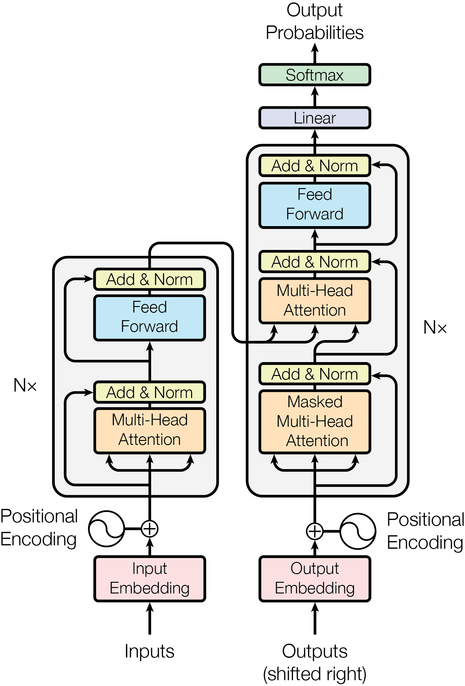
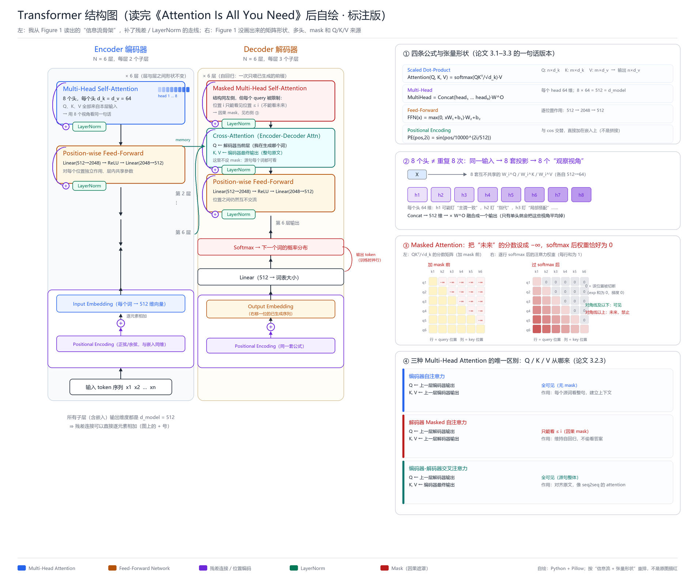
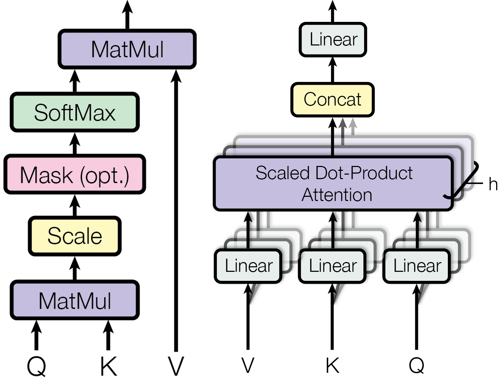
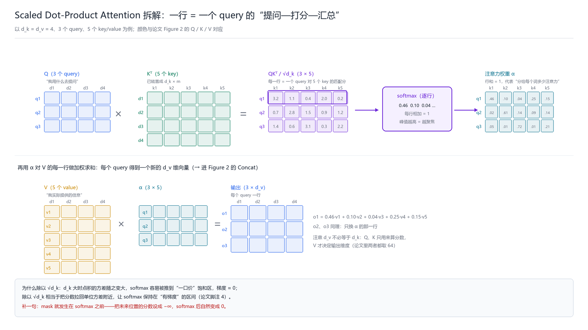

# 《Attention Is All You Need》图文精讲

> 读本文件夹里的 `Attention is all you need.pdf`，按论文自己的章节顺序走，每讲一部分就配上对应的图。
> 图分两类：**原图**（从 PDF 里无损抽出来的 Figure 1、Figure 2）和**我自己重画的图**（把原理拆开，方便看懂）。

---

## 一、先看全局：这篇论文在讲什么

一句话：**把 RNN/CNN 从序列模型里拿掉，只留注意力，效果更好、训练更快。**

论文的证据链很直接：

- WMT2014 英德：**28.4 BLEU**，比之前最好（含 ensemble）高 2 BLEU 以上；
- WMT2014 英法：单模型 **41.8 BLEU**，新 SOTA；
- base 模型 8 张 P100 训 **12 小时**就超过当时所有单模型；
- 还能直接拿去做英语成分句法分析，F1 91.3/92.7。

---

## 二、第 1–2 节：为什么非要扔掉 RNN

**RNN 的死穴**：`h_t = f(h_{t-1}, x_t)`，第 t 步必须等第 t-1 步。

- 一句话 50 个词，就得串行算 50 步，**句子内部没法并行**；
- 信息从第 1 个词传到第 50 个词要经过 50 次变换，**长依赖很难学**；
- 序列越长，显存越限制 batch 大小。

之前有人用 CNN（ByteNet、ConvS2S）来并行，但卷积只看局部，两个相距很远的词要经过很多层才能“见面”，路径长度随距离增长。

作者的赌注：**注意力本来就能“无视距离”地建模依赖，那为什么不只用注意力？**

---

## 三、第 3 节 Model Architecture（全文核心，配图）

### 3.1 原图 Figure 1



这是论文的 Figure 1 原图（从 PDF 里直接抽出来的，1520×2239，未压缩）。先整体看：

- **左半边 = Encoder**：`Inputs` → `Input Embedding` → ⊕ `Positional Encoding` → 大框 `N×`（里面是 `Multi-Head Attention` + `Add & Norm`，再 `Feed Forward` + `Add & Norm`）；
- **右半边 = Decoder**：`Outputs (shifted right)` → `Output Embedding` → ⊕ `Positional Encoding` → 大框 `N×`（`Masked Multi-Head Attention` + `Add & Norm`，`Multi-Head Attention` + `Add & Norm`，`Feed Forward` + `Add & Norm`）→ `Linear` → `Softmax` → `Output Probabilities`；
- **中间那根从编码器顶部绕到解码器中间注意力方块的弧线**：就是编码器输出，作为 K、V 送进交叉注意力。

几个容易被忽略的细节：

1. 编码器的大框里，`Multi-Head Attention` 下面的输入箭头画成了**三个分叉**——那是在表示 Q、K、V 三路投影（虽然是自注意力，三者同源）。
2. 解码器的第二个 `Multi-Head Attention` 同样有三个输入箭头：两个来自下方（解码器自己），一个来自左边（编码器）——这就是交叉注意力的标志。
3. 每个子层左上角那个**绕过去的弧线 + `Add & Norm`**，就是残差连接 + LayerNorm。
4. `N×` 写在框外，表示这一整块要**重复 N = 6 次**，但图上只画了一层。

### 3.2 我重画的标注版（把细节补齐）



原图是“好看但信息密度不高”的示意图。我重画时补了原图没画的：

- 残差弧线到底**接到哪**（接在 LayerNorm 之前，即 `LayerNorm(x + Sublayer(x))`）；
- `d_model = 512` 这个维度约束（所有子层输出必须同维，残差才能直接相加）；
- 三个注意力的 **Q/K/V 来源**（右侧 ④）；
- mask 的**分数矩阵 → 权重矩阵**对应关系（右侧 ③）；
- 8 个头的**投影关系**（右侧 ②）。

### 3.3 Encoder：每层只有两个子层

论文 3.1 原文：

> "The encoder is composed of a stack of N = 6 identical layers. Each layer has two sub-layers. The first is a multi-head self-attention mechanism, and the second is a simple, position-wise fully connected feed-forward network. We employ a residual connection around each of the two sub-layers, followed by layer normalization."

翻译成结构：

```
输入 x
 ├─→ [Multi-Head Self-Attention] → ⊕(x) → LayerNorm
 └─────────────────────────────────↑（残差）
 ├─→ [Feed-Forward]              → ⊕    → LayerNorm
 └─────────────────────────────────↑（残差）
```

- **6 层**，每层 2 个子层；
- 所有子层、所有嵌入的输出维度都是 **d_model = 512**；
- 公式：`LayerNorm(x + Sublayer(x))`。

一句话：**编码器把源句读成一串“带上下文”的 512 维向量**，每个位置都已经混合了整句信息（双向，无 mask）。

### 3.4 Decoder：每层三个子层

论文 3.1 原文：

> "In addition to the two sub-layers in each encoder layer, the decoder inserts a third sub-layer, which performs multi-head attention over the output of the encoder stack. ... We also modify the self-attention sub-layer in the decoder stack to prevent positions from attending to subsequent positions."

结构：

```
输入 y（右移一位）
 ├─→ [Masked Multi-Head Self-Attention] → ⊕ → LayerNorm
 ├─→ [Multi-Head Attention]  ← 编码器输出作为 K,V → ⊕ → LayerNorm
 ├─→ [Feed-Forward] → ⊕ → LayerNorm
```

三处关键差异：

1. **多一个交叉注意力子层**；
2. **自注意力加了 mask**，位置 i 只能看 ≤ i；
3. **输出右移一位**：输入是 `[BOS, y1, …, y_{i-1}]`，所以“预测第 i 个词”时模型只能看到第 i 个之前的内容。mask 和右移是同一件事的两面。

### 3.5 注意力机制：核心公式（配原图 Figure 2）



这是论文 Figure 2 原图：**左边是 Scaled Dot-Product Attention，右边是 Multi-Head Attention**。

**左边这张图（逐块读）**：

```
Q ─┐
   ├─ MatMul ── Scale ── Mask(opt.) ── SoftMax ── MatMul ── 输出
K ─┘                                                ↑
                                                    V
```

对应公式：

```
Attention(Q, K, V) = softmax( QKᵀ / √d_k ) · V
```

| 步骤 | 做什么 | 形状 |
| --- | --- | --- |
| MatMul | Q 和 K 做点积 | n×m |
| Scale | 除以 √d_k | n×m |
| Mask (opt.) | 解码器里把未来位置设成 −∞ | n×m |
| SoftMax | 逐行归一化 | n×m |
| MatMul | 用权重乘 V | n×d_v |

注意 `Mask (opt.)` 这个方块：**它是可选的**，编码器不用、解码器的自注意力用、交叉注意力不用。这跟我画在图 1 右侧 ③ 的 mask 矩阵是同一个东西。



我这张图把公式拆成了矩阵运算：`Q (3×4) × Kᵀ (4×5) = 分数 (3×5)`，逐行 softmax 得到 `α`（行和 = 1），再 `α × V (5×4) = 输出 (3×4)`。**输出维度由 V 的 d_v 决定，不由 Q/K 的 d_k 决定**——这一点原图 Figure 2 看不出来。

**右边这张图（逐层读）**：

```
V ── Linear ──┐
K ── Linear ──┼─ Scaled Dot-Product Attention（叠了 h 层）── Concat ── Linear ── 输出
Q ── Linear ──┘
```

- 底部三个 `Linear` 就是 `W_i^Q、W_i^K、W_i^V`；
- 中间那个画了**一叠方框**、旁边标 `h` 的，就是 h 个并行的注意力；
- 顶部 `Concat` 拼起来，再 `Linear`（即 `W^O`）融合。

论文的配置：`h = 8`，`d_k = d_v = d_model / h = 64`。

### 3.6 三种注意力的用法（论文 3.2.3）

| 位置 | Q 来自 | K、V 来自 | 可见范围 |
| --- | --- | --- | --- |
| 编码器自注意力 | 上一层编码器 | 上一层编码器 | 全句 |
| 解码器 Masked 自注意力 | 上一层解码器 | 上一层解码器 | 只看 ≤ 当前位置 |
| 解码器交叉注意力 | 上一层解码器 | 编码器最终输出 | 全句（源句） |

原图 Figure 1 里，解码器中第二个 `Multi-Head Attention` 的**三个输入箭头**就是在画这个：两个从下面来（Q 和 K/V 同源），一个从左边来（编码器给的 K/V）。

### 3.7 逐位置前馈网络（3.3）

```
FFN(x) = max(0, xW₁ + b₁)W₂ + b₂
```

`512 → 2048 → 512`，**对每个位置独立、所有位置共享参数**。

- 作用：给每个位置提供非线性。注意力本质是“加权平均”（线性），没有 FFN 的话模型表达能力很弱；
- 它是参数量的主体（每层约 210 万参数）；
- **它不混合词与词**——混合位置是注意力的工作。

### 3.8 嵌入与 Softmax（3.4）

- 词嵌入维度 `d_model = 512`，权重乘 `√d_model`；
- **编码器嵌入、解码器嵌入、输出 Linear 共享同一个权重矩阵**（输入输出绑定）；
- 解码器最后 `Linear → Softmax` 得到下一个词的概率分布。

### 3.9 位置编码（3.5）

公式：

```
PE(pos, 2i)   = sin( pos / 10000^(2i/512) )
PE(pos, 2i+1) = cos( pos / 10000^(2i/512) )
```

三个要点：

1. **为什么必须加**：注意力对词序是**置换等变**的——打乱词序，输出只是跟着打乱，模型自己分不清“猫追狗”和“狗追猫”；
2. **为什么直接相加**：位置编码和词嵌入都是 512 维，相加不改变维度，可以共用后续所有矩阵；
3. **为什么用正弦**：对固定偏移 k，`PE(pos+k)` 可以写成 `PE(pos)` 的线性函数，模型容易学“相对位置”；还能外推到更长序列。

论文也试了可学习的位置嵌入（Table 3 行 E），结果几乎一样（25.7 vs 25.8），选正弦是为了外推性。

---

## 四、第 4 节 Why Self-Attention：配 Table 1 讲

这一节是全论文最有洞察的地方：用三个指标比较不同层。

| 层类型 | 每层复杂度 | 串行步数 | 最长路径 |
| --- | --- | --- | --- |
| 自注意力 | O(n²·d) | **O(1)** | **O(1)** |
| 循环 RNN | O(n·d²) | O(n) | O(n) |
| 卷积 | O(k·n·d²) | O(1) | O(log_k n) |

- **串行步数**决定并行度：自注意力一步算完所有位置，RNN 要 n 步；
- **最长路径**决定长依赖好不好学：自注意力任意两位置直连，RNN 要穿 n 步，卷积要穿 log_k n 层。

**代价**：自注意力是 O(n²·d)，长序列很贵。论文提了个思路：把注意力限制在邻域 r 内，复杂度降到 O(r·n·d)，留给未来工作。

另一个好处是**可解释性**：附录的注意力可视化显示，不同头确实在做不同的事。

---

## 五、第 5 节 训练

**数据**

- 英德：WMT2014，450 万句对，BPE，共享词表约 37000；
- 英法：WMT2014，3600 万句对，word-piece，32000 词表。

**硬件/时间**

- 8×P100；base 每步 0.4 秒、10 万步（12 小时）；big 30 万步（3.5 天）。

**优化器**

- Adam，β₁ = 0.9，β₂ = 0.98，ε = 1e−9；
- 学习率：

```
lrate = d_model^(−0.5) · min(step^(−0.5), step · warmup^(−1.5))
```

**先线性升温（4000 步），再按平方根倒数衰减**——后来成了 Transformer 的标配。

**正则化**

- Residual Dropout：子层输出在“加残差、归一化之前”做 dropout；嵌入+位置编码的和也做 dropout（base 0.1，big 英德 0.3、英法 0.1）；
- Label Smoothing：ε_ls = 0.1，PPL 变差但 BLEU 变好。

**推理**：beam search，beam = 4，长度惩罚 α = 0.6；结果取最后若干 checkpoint 平均。

---

## 六、第 6 节 结果

| 模型 | 英德 BLEU | 英法 BLEU | 训练成本（FLOPs） |
| --- | --- | --- | --- |
| ByteNet | 23.75 | — | — |
| GNMT + RL | 24.6 | 39.92 | 2.3×10¹⁹ / 1.4×10²⁰ |
| ConvS2S | 25.16 | 40.46 | 9.6×10¹⁸ / 1.5×10²⁰ |
| MoE | 26.03 | 40.56 | 2.0×10¹⁹ |
| GNMT + RL Ensemble | 26.30 | 41.16 | 1.8×10²⁰ / 1.1×10²¹ |
| ConvS2S Ensemble | 26.36 | 41.29 | 7.7×10¹⁹ / 1.2×10²¹ |
| **Transformer (base)** | 27.3 | 38.1 | 3.3×10¹⁸ |
| **Transformer (big)** | 28.4 | 41.8 | 2.3×10¹⁹ |

**消融（Table 3，英德 dev BLEU）**

| 变化 | BLEU |
| --- | --- |
| 单头（h=1） | 24.9 |
| **8 头（base）** | **25.8** |
| h=16 | 25.1 |
| h=32 | 25.4 |
| 减小 d_k | 变差 |
| 减小 d_ff / d_model | 变差 |
| 去掉 dropout | 明显变差 |
| 可学习位置嵌入（行 E） | 25.7（与 25.8 几乎一样） |

结论：多头有用但 8 左右最好；模型越大越好（受算力限制）；dropout 很重要；正弦和可学习位置编码打平。

**句法分析**：4 层 Transformer 在 WSJ only 上 F1 = 91.3，半监督 92.7，超过之前所有模型，仅次于专门设计的 RNN Grammar。说明架构通用。

---

## 七、附录：注意力可视化（Figure 3–5）

这三张图是论文用来支撑“可解释性”的证据，都是**第 5 层（共 6 层）编码器自注意力**的可视化。

### Figure 3：长距离依赖

> 原文图注：**"An example of the attention mechanism following long-distance dependencies in the encoder self-attention in layer 5 of 6. Many of the attention heads attend to a distant dependency of the verb `making', completing the phrase `making ... more difficult'. Attention shares shown only for the word `making'. Different colors represent different heads."**

怎么读：

- 横轴是句子里的词，纵轴是 8 个头；
- **每个头用一种颜色**画出它对各个词的注意力强度；
- 只看 `making` 这一个词：很多头把注意力投到了远处的 `more` 和 `difficult` 上——正好补全 `making ... more difficult` 这个短语。
- 这说明**一个词可以直接“够到”很远的词**，不需要像 RNN 那样一层层传。

### Figure 4：指代消解

> 原文图注：**"Two attention heads, also in layer 5 of 6, apparently involved in anaphora resolution. Top: Full attentions for head 5. Bottom: Isolated attentions from just the word `its' for attention heads 5 and 6. Note that the attentions are very sharp for this word."**

怎么读：

- 句子是 “The Law will never be perfect, but its application should be just…”；
- **上**：head 5 的完整注意力矩阵（每个词对每个词）；
- **下**：单独看 `its` 这个词，head 5 和 head 6 的注意力分布；
- 关键结论：`its` 的注意力**非常尖**，几乎全部指向 `Law`——两个头都学会了做指代消解。

### Figure 5：句法结构

> 原文图注：**"Many of the attention heads exhibit behaviour that seems related to the structure of the sentence. We give two such examples above, from two different heads from the encoder self-attention at layer 5 of 6. The heads clearly learned to perform different tasks."**

怎么读：

- 两个不同头的注意力矩阵；
- 它们明显在跟踪**句法结构**（比如某个词只注意它的直接修饰对象）；
- 结论：**不同的头确实在学不同的任务**，这直接支持了多头设计的必要性。

> 附注：Figure 3–5 在 PDF 里是矢量绘制的彩色小方块/热力图，我这里用原图注 + 论文正文的描述来讲，没有硬凑一张重绘图。想亲眼看的话直接翻 PDF 第 13–15 页。

---

## 八、第 7 节 结论

- 提出 Transformer，**第一个完全基于注意力的序列转换模型**；
- 用多头自注意力取代循环层；
- 翻译上更快更好，达到新 SOTA；
- 未来工作：用到图像/音频/视频，研究受限注意力处理长序列，让生成过程更少串行。

---

## 九、把全文串起来

如果只记三句话：

1. **结构上**：用“自注意力 + FFN”的重复块替掉“RNN 时间步”的重复块——所有位置并行、任意两位置直连；
2. **机制上**：Q/K/V 三件套 + 缩放点积 + 多头 + mask，让模型并行地从多角度建立词与词的关系；
3. **工程上**：残差 + LayerNorm 让 6 层训得稳，位置编码补顺序，warmup + 逆平方根学习率 + dropout + label smoothing 让它收敛。

**影响**：BERT 只用编码器，GPT 只用解码器，ViT 把图切成 patch 也用同一套结构。2018 年之后的主流大模型，骨架基本都在这篇论文里。

**局限**：O(n²) 复杂度；位置编码只加一次；推理仍串行；Post-LN 在深模型下要 warmup；超参（6 层、8 头、2048）更多是算力约束下的经验折中。

---

## 附：本文件夹里的图

| 文件 | 说明 |
| --- | --- |
| `figures/pdf-fig1-architecture.png` | 论文 Figure 1 原图（PDF 无损抽取） |
| `figures/pdf-fig2-attn.png` | 论文 Figure 2 原图（PDF 无损抽取） |
| `figures/fig1-transformer-overview.png` | 我重画的标注版（补残差/LN、mask、Q/K/V 来源） |
| `figures/fig2-simplified-flow.png` | 我重画的简化数据流版 |
| `figures/fig3-attention-detail.png` | 我重画的注意力矩阵拆解版 |
